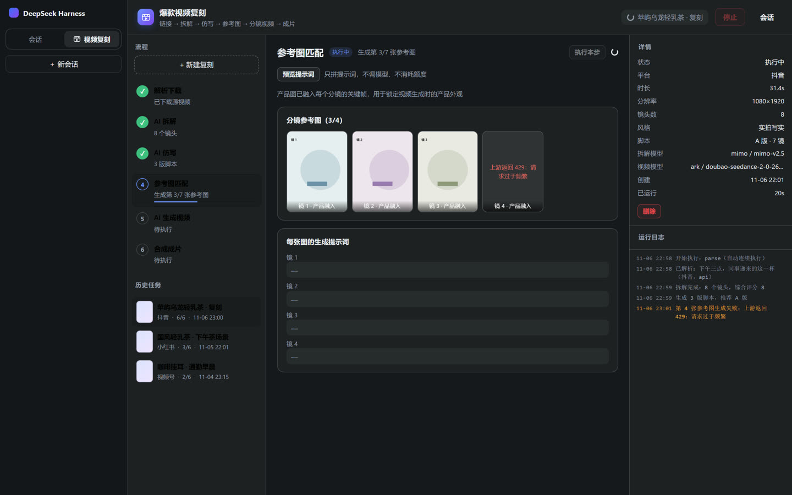
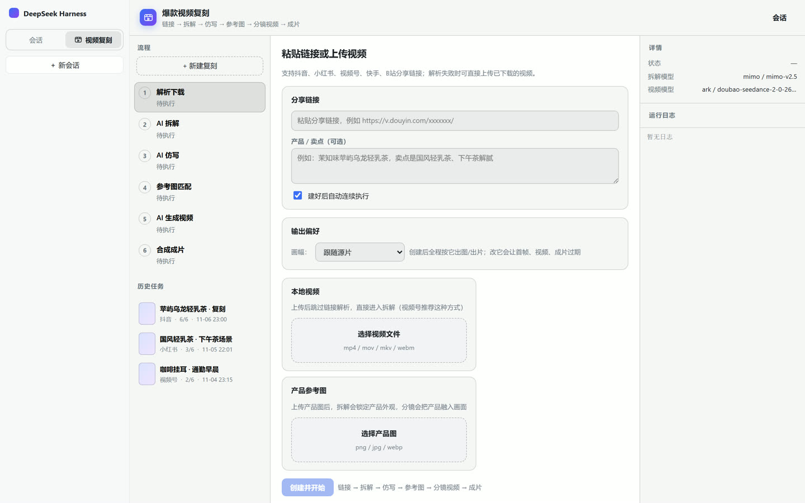

# dsh-video-replica · 爆款视频复刻工作台

[](https://github.com/limomss-dunang/dsh-video-replica/actions/workflows/ci.yml) [](LICENSE)

官网：[dimexplore.com](https://dimexplore.com)（[产品中心](https://dimexplore.com/products.html) · [案例场景](https://dimexplore.com/cases.html)）

DeepSeek Harness（DSH）插件。粘贴抖音 / 小红书 / 视频号等分享链接，或上传本地视频，
即可依次进行下载解析、AI 拆解、脚本仿写、参考图匹配、分镜视频生成和合成，产出视频成片。
生成效果和耗时取决于所选模型与服务。分享链接能否解析取决于平台、解析服务和登录状态；本地视频上传可作为起点。

[安装](#安装) · [快速开始](#快速开始) · [模型配置](#模型配置) · [排障](#排障) · [贡献指南](CONTRIBUTING.md)

流程参考同类产品的六步管线并补上「一键发布」；界面形态参考 dsh-imagegen
的「侧边栏入口 + 中栏三栏工作台 + 设置页」。





```
①解析下载 → ②AI拆解 → ③AI仿写 → ④参考图匹配 → ⑤生成视频 → ⑥合成成片 → ⑦一键发布
  链接/上传   抽帧+视觉   A/B/C三版   角色锚点+产品     分镜成片    拼接+字幕    视频号/抖音
```

## 安装

> **给 AI / 命令行的最短路径**：clone → `npm install` → `npm run build` → `node scripts/install.mjs`。
> 脚本会把插件复制进 DSH profile，并自动挂进 `dsh.profile.bundles`；装完只需**彻底重启 DSH**。

### 一条命令安装（推荐，AI 可直接执行）

前置条件：DSH 至少启动过一次（已生成 `~/.dsh/profiles/<profile>`）、Node.js **22.18+ / 24.11+**、
`ffmpeg` 与 `ffprobe` 在 PATH（或稍后在插件设置里填绝对路径）。

macOS / Linux：

```bash
git clone https://github.com/limomss-dunang/dsh-video-replica.git
cd dsh-video-replica
npm install          # prepare 会自动构建 lib/
npm run build        # 再显式构建一次，确保 lib/index.js + lib/client.js 是新的
node scripts/install.mjs
```

Windows（PowerShell）：

```powershell
git clone https://github.com/limomss-dunang/dsh-video-replica.git
cd dsh-video-replica
npm install
npm run build
node scripts/install.mjs
```

脚本会自动探测 `~/.dsh/profiles/desktop`，找不到再用 `web`。多 profile / 自定义 DSH_HOME：

```bash
node scripts/install.mjs --profile web
DSH_PROFILE_ROOT=/path/to/profile node scripts/install.mjs
```

**装完的判定标准**

1. 脚本输出 `✓ 复制插件包`、`✓ 已加入 … dsh.profile.bundles`；
2. **完全退出 DSH 再重新打开**（刷新窗口不算，宿主不会重新加载插件）；
3. 侧边栏出现「视频复刻」，设置里出现「视频复刻」配置页；
4. 打开工作台能点「新建复刻」（没配模型会提示去设置）。

**升级**：`git pull && npm install && npm run build && node scripts/install.mjs`，再重启 DSH。

**卸载**：删除 `<profile>/node_modules/dsh-video-replica`，并从该 profile 的 `package.json`
里删掉 `dsh.profile.bundles` 中的 `dsh-video-replica`。

### 图形界面安装（备用）

```bash
npm install && npm pack     # 生成 dsh-video-replica-<版本>.tgz
```

在「设置 → 插件 → 安装插件」选择这个 tarball（或 Releases 页里的 tgz）。
GitHub 自动生成的 **Source code (zip / tar.gz)** 不含构建产物 `lib/`，不能直接装。

### 前置条件（详细）

- 已安装支持 Cordis 插件与客户端工作台的 DeepSeek Harness；本插件需要在宿主内运行。
- 从源码构建时用 Node.js **22.18+（22.x）或 24.11+（24.x）**，与构建工具要求一致。
- 安装 `ffmpeg`、`ffprobe` 并加入 PATH，或在插件设置里填写可执行文件路径。
- 可选安装 `yt-dlp`，用于部分平台下载；也可以走解析服务或直接上传本地视频。
- 准备支持视觉理解、文本、图片、视频生成的模型服务；语音识别（ASR）与配音（TTS）可选。
  模型调用可能产生费用。

## 快速开始

1. 打开 **设置 → 视频复刻配置**，按需填写各步骤的接口地址 / API Key / 模型名，
   点「测试」确认连通（`ffmpeg` / `ffprobe` / `yt-dlp` 的状态会显示在「环境状态」里）。
2. 侧边栏点「视频复刻」→「新建复刻」。
3. 粘贴分享链接，或选择本地视频；可选：填产品/卖点简述、上传产品图。
4. 首次使用建议逐步执行：在「② AI 拆解」核对内容，在「③ AI 仿写」选择 A/B/C 版本并修改脚本，再执行素材生成。确认接口与脚本合适后，可用「创建并开始」连续执行前六步（发布是手动步骤，不会自动发出去）。
5. 在「④ 参考图匹配」检查每张分镜关键帧（可单张重新生成），
   在「⑤ AI 生成视频」检查每段成片（可单段重试），最后在「⑥ 合成成片」下载 `final.mp4`。

模型生成与重试会消耗上游额度。自动流程会继续执行后续步骤；需要先审稿时使用逐步执行。点「停止」中止本地调度和等待，上游已接收的任务是否停止或退费取决于服务商。

## 七步各自做什么

| 步骤 | 输入 | 做什么 | 产出 |
|---|---|---|---|
| ① 解析下载 | 分享链接 / 本地视频 | 调解析接口或 yt-dlp 拿直链，下载到运行目录；ffprobe 探尺寸、ffmpeg 出封面 | `source/` 下的源视频、`source/thumb.jpg` |
| ② AI 拆解 | 源视频 | 均匀抽帧（默认 12 帧）+ 视觉模型逐镜拆解；可选 ASR 转写口播 | 分镜表、钩子、节奏、风格、爆款 DNA、评分、口播稿 |
| ③ AI 仿写 | 拆解结果 + 产品简述 | 文本模型按原片 DNA 仿写 A/B/C 三版分镜脚本 | 3 版脚本（可逐镜编辑） |
| ④ 参考图匹配 | 选定脚本 + 产品图 | 逐镜生成关键帧，产品外观以参考图为准 | `frames/ref-01.png …` |
| ⑤ 生成视频 | 分镜 + 关键帧 | 按「≤5 镜 / ≤15 秒」分块调视频模型，轮询并下载 | `segments/seg-01.mp4 …` |
| ⑥ 合成成片 | 分镜视频 + 脚本 | ffmpeg 统一画幅拼接、可选出 TTS 配音、ASS 字幕烧录、BGM | `final.mp4` |
| ⑦ 一键发布 | `final.mp4` | 打开平台创作页，未登录先扫码，然后自动上传、填描述、点发表（**手动步骤**，不参与自动连续执行） | 平台作品 |

## 模型配置

每一步的模型有两种来源，在设置页顶部标签里切换：

- **DSH 已配置模型（推荐）**：直接从「设置 → 模型」里已经配好的提供商与模型里选，
  不需要重复填地址和密钥。
  - ② 拆解 / ③ 仿写：走宿主 `llm` 服务（`llm.stream`），鉴权、重试、多模态编排都由 DSH 负责；
    抽帧图片经 `attachments` 转成附件后以图片内容块交给模型。
  - ④ 参考图 / ⑤ 视频 / ⑥ 配音 / 语音识别：DSH 没有这些模态的原生适配器，插件会从该提供商
    在组合配置里的 `baseURL`（以及 `apiKey` / `apiKeyEnv` 凭据）解析出接口地址，再用本插件
    的 HTTP 适配器发请求。提供商没写 `baseURL` 时界面会明确提示改用「手动填写接口」。
- **手动填写接口**：自填接口地址 + API Key + 模型名 + 协议，适合第三方聚合网关、自建服务。

「刷新模型」会重新探测 DSH 的提供商与模型列表；「用 DSH 默认模型」一键填入
「设置 → 模型」里的默认选择。

选「手动填写接口」时，每一步独立配置「接口地址 + API Key + 模型名 + 协议」，协议决定请求形状：

| 步骤 | 协议 | 说明 |
|---|---|---|
| ① 解析下载 | `parser-json` | 第三方解析服务。自动识别 HoxHox（`success:true`）与 RedFox（`code` 以 2 开头）两种响应；其它网关可用「视频地址字段路径」指定点路径。可再配一个**备用解析接口**：主接口失败（服务异常 / 鉴权 / 超时 / 拿不到视频地址）时自动切过去，日志会写明主接口为什么失败 |
| ② AI 拆解 | `chat` | OpenAI 兼容 `/chat/completions`，帧以 base64 `image_url` 传入 |
| ③ AI 仿写 | `chat` | OpenAI 兼容 `/chat/completions`，`response_format=json_object` |
| ④ 参考图 | `openai-images` | `/images/generations`；带参考图时走 JSON `image` 数组，被拒则自动改 `/images/edits` |
| ⑤ 生成视频 | `ark-seedance` / `openai-video` | 火山方舟 Seedance 任务协议，或通用 `/videos` + 轮询 |
| ⑥ 配音（可选） | `openai-tts` / `chat-tts` | `/audio/speech`，或聊天接口返回 base64 音频 |
| 语音识别（可选） | `openai-transcription` / `chat-asr` | `/audio/transcriptions`（multipart），或聊天接口音频输入，用于转写源片口播 |

配置示例见 [docs/MODELS.md](docs/MODELS.md)。

## 支持哪些链接

| 平台 | 链接形态 | 可靠路径 |
|---|---|---|
| 抖音 | `v.douyin.com/*`、`www.douyin.com/video/*` | 解析服务 / yt-dlp |
| 小红书 | `xhslink.com/*`、`www.xiaohongshu.com/explore/*` | 解析服务（推荐） |
| 视频号 | `channels.weixin.qq.com/*` | **需要支持视频号的解析服务**；否则下载后「本地视频」上传 |
| 快手 | `v.kuaishou.com/*` | 解析服务 / yt-dlp |
| B 站 | `b23.tv/*`、`bilibili.com/video/*` | yt-dlp |
| 视频直链 | 以 `.mp4` 等结尾 | 直接下载 |

解析模式 `auto` 会按「直链 → 解析接口 → yt-dlp」依次尝试，全部失败时错误信息里会列出
每一种方式的具体原因，并提示改用本地上传。

## 第七步：一键发布（视频号 / 抖音）

成片完成后进入「⑦ 一键发布」，切到目标平台、填短标题与描述，点「发布到视频号 / 发布到抖音」。
两个平台**互相独立**：发布结果分开记录（`run.publishes[平台]`），发完一个可以切到另一个继续发。

### 视频号

1. 宿主用 `playwright-core` 打开本机浏览器进视频号创作页（`channels.weixin.qq.com/platform/post/create`）；
2. 未登录时停在扫码页——在**弹出的浏览器窗口里用微信扫码**，登录后自动继续；
3. 编辑器在独立 iframe 里：脚本按 iframe 查找上传入口（CDP `DOM.setFileInputFiles`）、等视频上传完成、填描述、真实鼠标点击「发表」；
4. 成功后回填作品链接与截图。

### 抖音

1. 打开抖音创作者中心上传页（`creator.douyin.com/creator-micro/content/upload`）；
2. 未登录时用**抖音 App 扫码**；
3. 选文件上传 → 等预览视频就绪（`readyState >= 3` 且时长 > 0）→ 填作品标题与描述（富文本）→ 滚到底真实点击「发布」；
4. 成功后跳转内容管理页并回填状态。

> **短信验证**：抖音在同一账号短时间内多次发布时会触发风控，弹出「接收短信验证码」。
> 这一步平台要求本人操作，插件会进入 **「等待短信验证…」** 状态（最多 5 分钟），
> 你在浏览器窗口里点「获取验证码」、填入验证码即可继续。正常一次发布一般不会触发。

### 发布封面

「⑦ 一键发布」里可以给这次发布设置封面（不设则由平台自动截帧）：

- **上传封面**：png / jpg / webp；
- **从成片截帧**：填秒数，插件用 ffmpeg 从 `final.mp4` 截一帧；
- 发布时自动裁成 **3:4（个人主页 / 竖封面）** 与 **4:3（分享 / 横封面）** 再上传；
- 现状：**视频号支持自定义封面（已验证）**；抖音暂时沿用平台自动封面，自定义封面在后续版本支持。

### 共同要点

- **需要本机有 Chromium 系浏览器**：优先 playwright 自带 chromium，其次 Microsoft Edge / Google Chrome；
  都没有时用 `DSH_VIDEO_REPLICA_BROWSER` 指向可执行文件；
- **登录态存在独立 profile**：默认 `~/.dsh/browser-profiles/video-replica-publish`
  （可用 `DSH_VIDEO_REPLICA_PUBLISH_PROFILE` 改），两个平台共用，扫码一次长期复用；
- 发布是**手动步骤**：即使开着「自动连续执行」也不会自动发出去，必须你点一下；
- 失败时浏览器窗口会保留并写 `publish/<平台>-fail-*.png` 截图，可手动接管。

## 数据与隐私

- 配置：`~/.dsh/storages/dsh-video-replica/config.json`（可用环境变量
  `DSH_VIDEO_REPLICA_HOME` 覆盖整个默认数据根目录）；`~` 指运行 DSH 的操作系统账户主目录。设置中的运行产物目录只改变产物位置。
- 运行产物默认在 `<数据根目录>/runs/<runId>/`，可在设置中更改运行产物目录；包含源视频、抽帧、参考图、分镜视频和成片。
- API Key 以明文保存在本机配置文件中，依赖操作系统账户权限保护。界面回读时显示掩码；保留掩码可保留原密钥，清空后保存会清除密钥。
- 使用解析和模型服务时，链接、视频帧、产品图或文本会发送给所配置的服务商，请确认其数据处理方式。
- 桥接接口只对本机回环 + 同源请求开放（远端浏览器访问会被 403 拒绝）。

## 贡献与安全

- 开发环境、命令、代码结构与发版流程见 [CONTRIBUTING.md](CONTRIBUTING.md)。
- 安全问题请**不要**开公开 issue，走 [SECURITY.md](SECURITY.md) 里的私密报告通道。
- 本仓库运行时零第三方依赖；`devDependencies` 只用于构建与测试。

## 文档

| 文档 | 内容 |
|---|---|
| [架构与数据流](docs/ARCHITECTURE.md) | 宿主、工作台与六步流水线 |
| [模型与网关配置](docs/MODELS.md) | 各模态配置、请求协议与网关差异 |
| [提示词设计](docs/PROMPTS.md) | 写作规范与各阶段提示词 |

## 目录结构

```
src/
├── shared/        类型与路由常量（宿主/浏览器共用）
├── host/          宿主半边：配置、运行存储、引擎、六步流水线、模型适配、桥接路由
│   ├── providers/   chat / image / video / tts / asr / parser 适配器
│   ├── prompts.ts   拆解与仿写提示词
│   ├── pipeline.ts  六个步骤 + 单张/单段重生成
│   ├── media.ts     ffmpeg / ffprobe / 下载封装
│   ├── engine.ts    步骤调度、取消、自动推进
│   └── routes.ts    loopback 桥接（一个路径一条 WebRoute，方法内部分派）
└── client/        浏览器半边：侧边栏入口、中栏工作台、设置页
scripts/
├── smoke-host.mjs    宿主端到端冒烟（真实 ffmpeg + mock 模型网关）
├── smoke-client.mjs  jsdom 里加载真实 client bundle 验证挂载
└── preview/          用 playwright 渲染真实 bundle 生成界面截图
```

## 开发

```bash
npm run build                               # 构建宿主和客户端
npm run typecheck                           # tsc --noEmit
npm run smoke:host                          # 六步全流程（需要 ffmpeg/ffprobe）
npm run smoke:client                        # 客户端挂载与渲染
python scripts/preview/shots.py             # 界面截图 -> output/preview/
```

`smoke-host.mjs` 会起一个本地 mock 网关（聊天/图像/视频/TTS/解析），用真实 ffmpeg
生成素材并跑完整条流水线，最后校验成片时长、分辨率、音轨、Range 播放与目录穿越防护。
它把数据写到系统临时目录，不会碰你的真实配置。

## 排障

| 现象 | 原因 / 处理 |
|---|---|
| 已经配好模型，工作台仍提示「还没有配置模型」 | 工作台常驻挂载，改配置后需要它重新读一次。现在切回窗口、重新打开工作台、在设置里保存都会自动刷新；也可以点提示条右侧的「重新检测配置」。若仍不消失，刷新页面（客户端半边的改动只需刷新，宿主改动才需要重启）。 |
| 设置页里「DSH 已配置模型」下拉是空的 | DSH 的 `llm` 服务不可用或还没配置提供商。先到「设置 → 模型」确认有可用提供商与模型，再点「刷新模型」；仍然为空时看该位置是否报了读取失败。 |
| 图片 / 视频 / 语音步骤提示「提供商没有接口地址」 | 这些模态需要该提供商在 DSH 配置里写了 `baseURL`（聊天提供商通常有，但有些只用内置目录）。在「设置 → 模型」里补上接口地址，或在这一步改用「手动填写接口」。 |
| 保存分镜 / 重新生成后提示正在执行 | 同一时间只允许一个任务；先等它结束或点「停止」。 |
| 解析接口返回「抖音解析服务异常」等业务错误 | 先检查服务商返回的错误详情、额度和鉴权，HTTP 200 也可能包含业务失败；可配置备用解析服务，或改用本地视频上传。 |
| 「源视频无法解码」/ 之前的「抽帧失败」 | 解析服务返回了网页或风控页，被当成视频存了下来。插件现在会在「解析下载」这一步就校验（ffprobe 必须能识别出视频流），并报出实际原因与文件开头内容。处理：换可用的解析服务、开启「读取浏览器 Cookie」（yt-dlp 走你本地浏览器的抖音登录态），或直接上传视频文件。 |
| 「配音被跳过，沿用分镜自带音频」 | 脚本里没有口播/字幕文案时不再用 TTS 造一条静音轨。产品复刻（有产品图/卖点）会自动写口播；纯复刻若源片无口播则保持无台词。 |
| 语音识别报 404 / 「识别结果为空」 | 该网关不是 Whisper 协议。MiMo 的 `mimo-v2.5-asr` 走聊天接口：把「语音识别」的协议改成 `chat-asr`（选 `openai-transcription` 时插件也会在 404 时自动回退）。 |
| TTS 报「Unknown voice」 | 网关对音色名要求严格；插件会解析报错里的可用音色列表并自动挑一个（优先 `mimo_default`）重试，同时在日志里写明改用了哪个音色。想固定音色就把设置里的「音色」填成网关支持的名称。 |
| 重启后任务标为「上次执行被中断」 | 宿主重启会把未完成步骤标记为失败；当前不会按上游任务号自动续接。先核对服务商任务状态，再决定是否重新运行，避免重复提交。 |
| 中文字幕显示为方块 | 在运行 DSH 的机器上安装中文字体；系统缺少 `Microsoft YaHei` 时 libass 会选择替代字体。 |
| 侧边栏没有出现「视频复刻」 | 99% 是没真正重启 DSH（刷新窗口不算）。确认 `node scripts/install.mjs` 打印的 profile 目录是你在用的那个，并彻底退出再打开。 |
| 发布到抖音时弹「短信验证码」 | 平台风控（同一账号短时间内多次发布会触发）。插件会停在「等待短信验证…」状态，在打开的浏览器窗口里完成验证即可；正常一次发布一般不会弹。 |
| 视频号发布报「页面上没找到视频上传入口」 | 视频号编辑器在独立 iframe 里，旧版本号只查主页面。升级到 0.2.x 后按无障碍/iframe 方式查找；仍失败时看运行目录 `publish/post-fail-*.png` 截图。 |

## 已知限制

- **视频号**没有公开的免登录解析路径，纯 HTTP 解析不可靠；请用支持视频号的解析服务或本地上传。
- 视频生成耗时取决于上游，插件会轮询并显示进度。关闭工作台或刷新页面时，只要 DSH 宿主进程仍在运行，任务可继续；宿主退出或重启后需要人工处理未完成步骤。
- 字幕字体使用系统 `Microsoft YaHei`；如果宿主机没有该字体，libass 会回退到默认字体（中文可能显示为方块）。
- 不生成 BGM；BGM 只支持指定本机音频文件路径（版权自行负责）。
- 拆解质量依赖视觉模型的图像理解能力；未配置 ASR 时口播稿只能从画面文字推断，界面会明确提示。
- yt-dlp 下载部分平台时可能要求有效登录状态；若报 `Fresh cookies are needed`，可配置从本机浏览器读取 Cookie，或使用解析服务 / 本地上传。
- 视频网关可能忽略 `size`（例如返回 960×960 而非 9:16），合成本身会按源片比例缩放+补边兜底。
- 参考图与分镜视频的质量取决于所配置的图像/视频模型；不同网关对「参考图」协议的实现差异较大，
  必要时用「附加请求参数（JSON）」补齐网关私有字段。

本项目采用 [Apache-2.0 许可证](LICENSE)。问题反馈请提供插件版本、所在步骤和脱敏日志；提交前查看 [贡献指南](CONTRIBUTING.md)。
